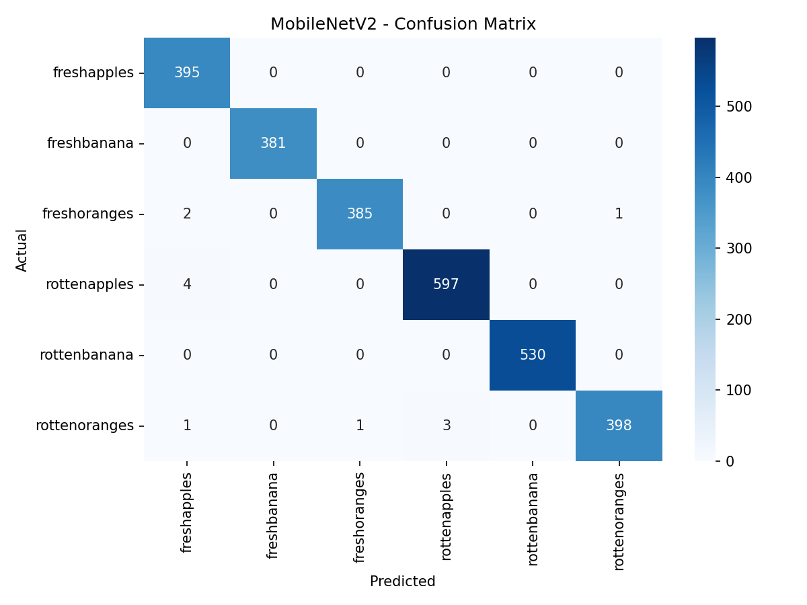
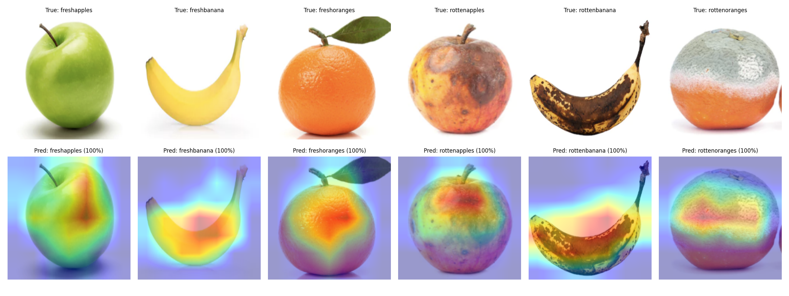
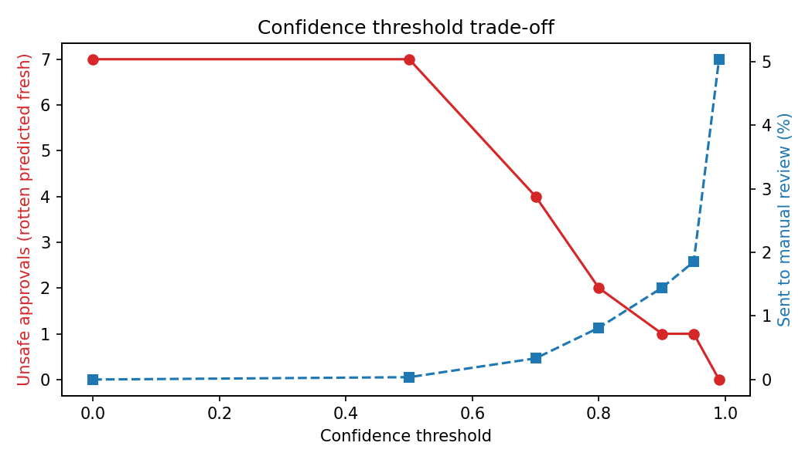

# FreshCheck: Deep Learning-Based Food Freshness Detection for Smart Food Donation

FreshCheck is a food donation platform (**FoodShare**) with a deep learning freshness check built in. Donors post surplus food with a photo, a CNN decides whether fruit is safe to give away, the system suggests the best nearby NGO, and a volunteer delivers it. Admins review everything the AI cannot judge.

> **Safety first.** Wrongly passing spoiled food is the worst error in this setting, so the system is tuned for *rotten recall*, not just accuracy. Anything the model is unsure about goes to a human.

## How it works

1. **Donate:** a donor posts food details, a pickup location and a photo.
2. **Verify (hybrid):**
   - Fruit: MobileNetV2 classifies the photo. Confident *fresh* is auto-approved, *rotten* is rejected, low confidence goes to manual review.
   - Everything else (vegetables, bread, cooked, packaged): manual admin review.
3. **Match:** NGOs are ranked by a weighted score: distance (0.4), urgency (0.3), remaining capacity (0.3). Distance uses the haversine formula.
4. **Deliver:** the NGO accepts, a volunteer claims the pickup, marks picked up, then delivered.
5. **Expire:** a background job expires donations past their use-before time.
6. **Impact:** the admin overview shows meals delivered, food saved and CO2e avoided.

## Model results

Dataset: fruit freshness images (fresh and rotten apples, bananas, oranges). Colab T4 GPU, TensorFlow/Keras.

| Model | Test accuracy |
|---|---|
| Baseline CNN | 98.18% |
| MobileNetV2 (transfer learning, last 30 layers fine-tuned, lr 1e-5) | **99.56%** |

**Safety metric: unsafe errors** (rotten predicted as fresh) on the test set:

| Confidence threshold | Unsafe errors |
|---|---|
| 0.00 (no threshold) | 7 |
| **0.90 (default)** | **1** |

Predictions below the threshold are sent to manual review instead of being auto-approved.

Figures are in [`docs/`](docs): confusion matrices for both models, Grad-CAM samples and the threshold trade-off curve.





## Tech stack

- **ML:** TensorFlow/Keras, MobileNetV2, data augmentation, Grad-CAM
- **Backend:** FastAPI, SQLAlchemy 2.0, SQLite, JWT auth (PyJWT), bcrypt, role-based access (donor, NGO, volunteer, admin)
- **Frontend:** plain HTML/CSS/JS single-page app served by FastAPI, optional Google Maps for locations
- **Matching:** haversine distance plus weighted scoring

## Run it locally

```bash
git clone https://github.com/jahnavi920/foodshare-ai.git
cd foodshare-ai/backend
python -m venv venv
venv\Scripts\activate          # Windows
pip install -r requirements.txt
uvicorn app.main:app --reload
```

- App: http://127.0.0.1:8000/app/
- API docs: http://127.0.0.1:8000/docs

Create an admin account:

```bash
python create_admin.py
```

**Optional Google Maps:** copy `frontend/config.example.js` to `frontend/config.js` and add a Maps JavaScript API key (enable Maps JavaScript API and Geocoding API, restrict the key to `http://127.0.0.1:8000/*`). Without a key the app still works, using "Use my location" or typed latitude/longitude.

> The trained model files (`ml/*.keras`) and the dataset are not in git if they exceed GitHub size limits. Place `mobilenet_finetuned.keras` in `ml/` before running verification.

## Main API endpoints

| Area | Endpoints |
|---|---|
| Auth | `POST /auth/register`, `POST /auth/login`, `GET /auth/me` |
| Donations | `POST /donations`, `GET /donations/mine`, `GET /donations/available`, `GET /donations/{id}/matches` |
| AI | `POST /predict`, `POST /donations/{id}/verify` |
| NGO | `PUT/GET /ngos/me`, `GET /ngos` |
| Pickups | `POST /donations/{id}/accept`, `GET /pickups/open`, `POST /pickups/{id}/claim`, `/picked-up`, `/delivered` |
| Admin | `GET /admin/review-queue`, `POST /admin/donations/{id}/review`, `GET /admin/stats` |

## Limitations and future work

- The classifier knows only apples, bananas and oranges. Other food types go to manual review by design.
- Planned: vegetable and bread classes, rules for cooked and packaged food (time since preparation, storage), a larger set of real-world photos.
- Development setup: SQLite and open CORS. A production deployment needs PostgreSQL, restricted CORS and a secret key from the environment.

## Author

Jahnavi Madhyahanapu, B.Tech AI & Data Science, Ramachandra College of Engineering.
